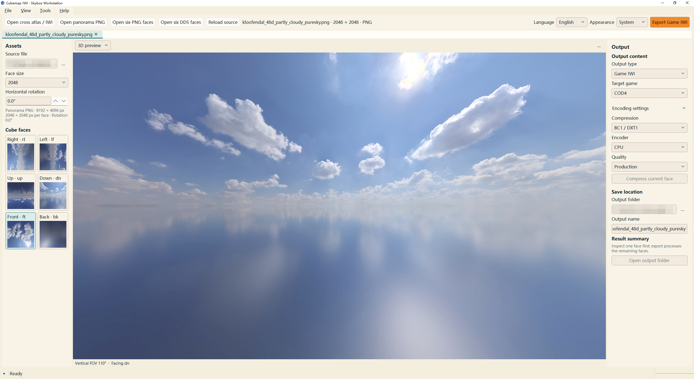
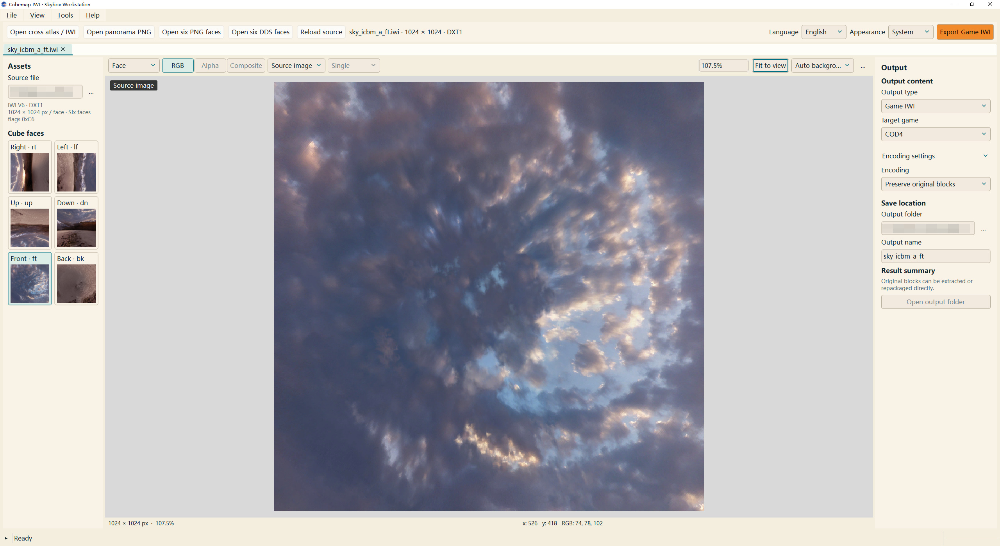
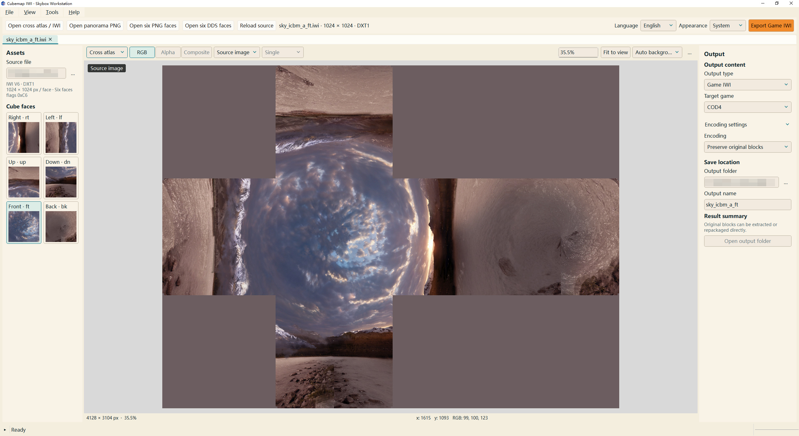
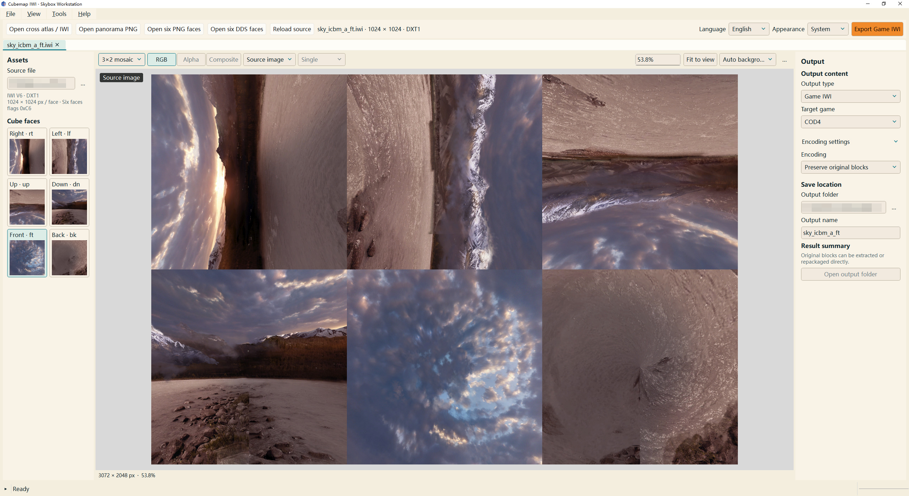
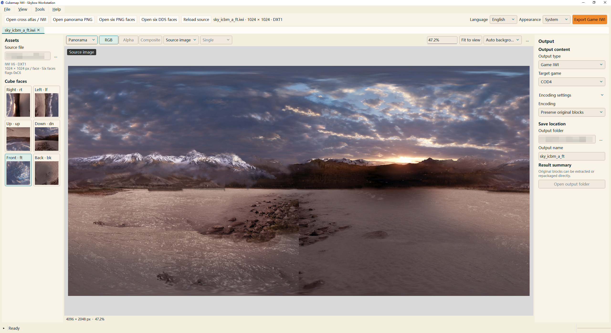
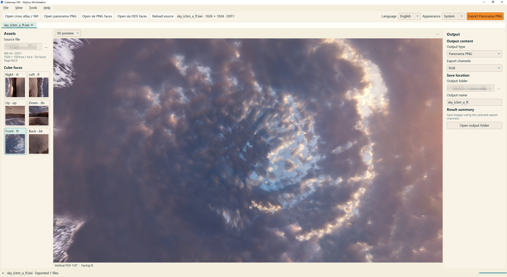

# Cubemap IWI Tool

[简体中文](README.md) | English

Cubemap IWI Tool is a desktop application for creating, converting and previewing Call of Duty skybox textures. It currently supports Call of Duty 4, Modern Warfare 2 and Modern Warfare 3. Cross atlases, equirectangular panoramas and six-face image sets can be converted to IWI; existing IWI files can be opened and exported as individual faces or unfolded layouts. The 2D canvas provides channel views and compression comparisons, while the 3D preview allows inspection of face orientation and seams.

See the [English User Guide](UserGuide.md) or [中文使用说明](使用说明.md) for operating instructions.

## Screenshots

Import a panorama PNG, choose the face size and horizontal rotation, inspect the assembled skybox in 3D, and export a game IWI.



An IWI can be viewed as a single face, cross atlas, six-face mosaic, panorama or interactive 3D skybox.

| Single face | Cross atlas |
| --- | --- |
|  |  |

| Six-face mosaic | Panorama |
| --- | --- |
|  |  |



## Supported formats

Image input supports cross atlas PNGs, 2:1 equirectangular panorama PNGs and six-face PNG sets. DDS input supports DXT1/DXT5 with a legacy single-face FOURCC header. IWI input supports COD4 v6 and MW2/MW3 v8 in RGB24, DXT1 and DXT5. DDS and IWI inputs must contain a single mip level. Image output includes six-face PNG sets, cross atlases, 3×2 mosaics and panoramas, with RGB, Alpha or RGBA channel selection.

For the stock engines’ image-loading capacity and requirements for larger assets, see **Stock engine capacity** in the user guide.

## System requirements and release package

The application runs on Windows 10/11 x64. The 3D preview requires a graphics driver with OpenGL 3.3 support.

The current release is V1. Download `Cubemap_IWI_ToolV1.zip` from [Releases](https://github.com/PilotBadminton/Cubemap-IWI-Tool/releases), extract it and run `Cubemap_IWI_Tool.exe`. The package includes runtime dependencies, bilingual user guides, diagrams and third-party licenses. Keep the extracted directory structure intact.

## Development and building

The development environment uses Python 3.14 x64. Python dependency versions are listed in `requirements.txt` and `requirements-build.txt`; the NVTT interface targets NVIDIA Texture Tools SDK 3.2.5.

Set `NVTT_SDK_DIR` to the SDK root directory, which must contain `nvtt30205.dll`, `LICENSE.TXT` and `license_information.txt`. Then install the dependencies and run the application from source.

```powershell
python -m pip install -r requirements.txt
python cubemap_iwi_tool.py
```

Run the packaging script from the project root.

```powershell
./build_exe.ps1
```

The script installs build dependencies in `.build-env` and produces the portable directory `dist/Cubemap_IWI_Tool/` and archive `dist/Cubemap_IWI_ToolV1.zip`. Two parameters override the default Python interpreter and SDK location.

| Parameter | Purpose | Default |
| --- | --- | --- |
| `-Python` | Python interpreter used to create the build environment | `python` on PATH |
| `-NvttSdk` | NVTT SDK root directory for this build | `NVTT_SDK_DIR` environment variable |

## Source layout and checks

`skybox/` contains format handling, image projection, NVTT integration and the desktop interface. `tools/` contains packaging hooks and license collection scripts. `docs/figures/` contains editable SVG diagrams and the PNGs used in the user guides.

After installing dependencies and configuring the SDK, run the format, seam, Alpha and encoding checks based on synthetic images.

```powershell
python -m unittest discover -s tests
```

The diagrams are stored as SVGs and rendered to PNG at three times their logical resolution. To regenerate all diagrams in a Windows development environment:

```powershell
python tools/render_figures.py
```

## License

The project’s own source code and documentation are licensed under the [MIT License](LICENSE). Qt/PySide6 is used under LGPLv3, and the NVTT runtime is subject to NVIDIA’s proprietary license. Other dependencies retain their respective licenses. Source download links, shared-library replacement instructions and the complete component index are provided in [Third-party notices](licenses/Third-party-notices.txt).
