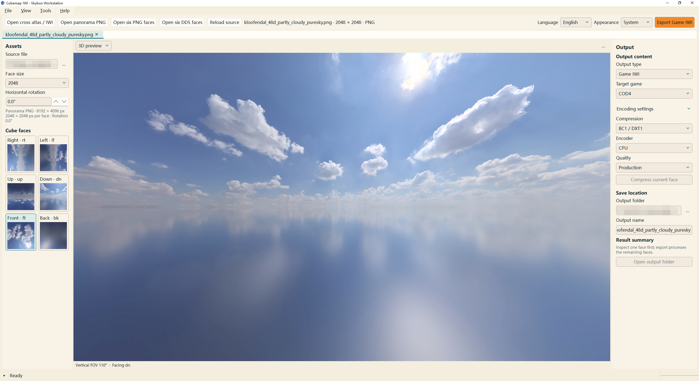
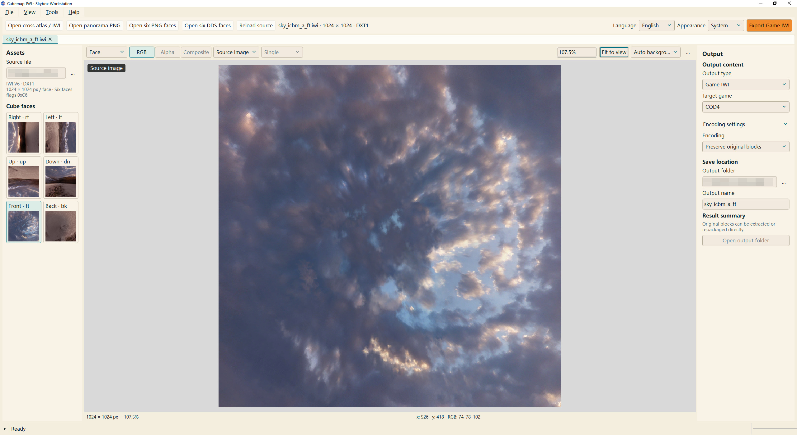
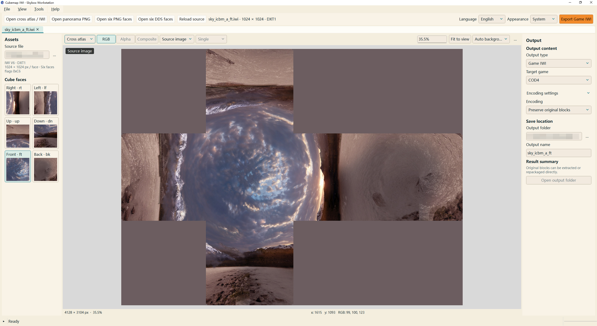
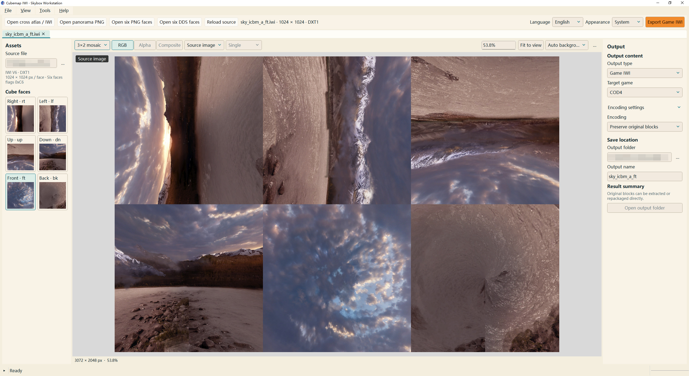
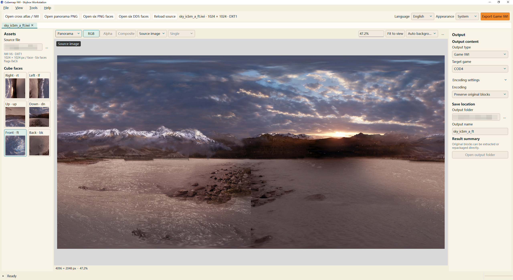
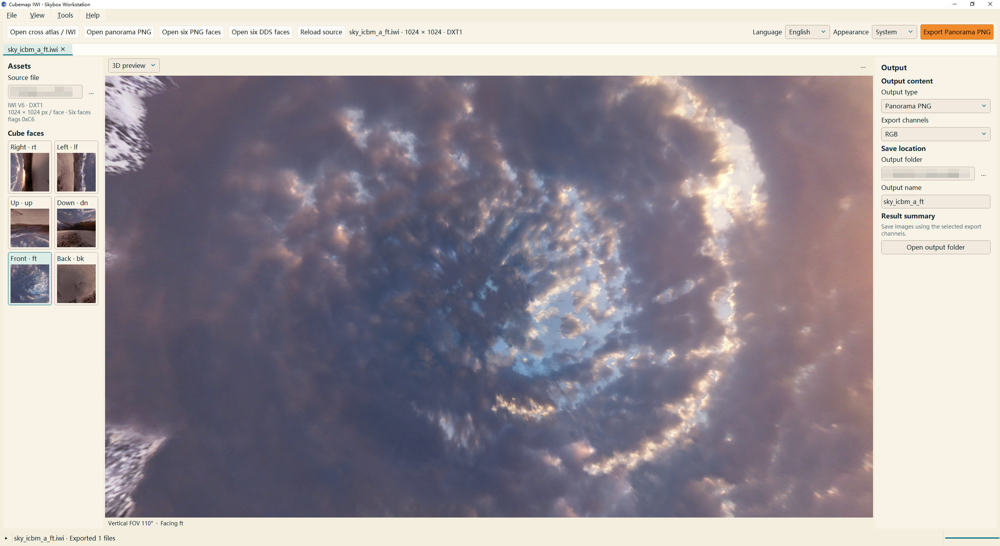

# Cubemap IWI Tool

简体中文 | [English](README.en.md)

Cubemap IWI Tool 用于 COD4、MW2 和 MW3 天空盒的制作、格式转换与预览。程序可将十字图、等距柱状全景图或六面贴图转换为 IWI，也可读取现有 IWI 并导出六面贴图或展开图。二维画布提供通道查看和压缩对照，三维预览用于检查面朝向与接缝。

操作说明见[中文使用说明](使用说明.md)及[English User Guide](UserGuide.md)。

## 界面展示

全景 PNG 导入后，可设置单面尺寸与水平朝向，在 3D 视图中检查六面拼接，并导出游戏 IWI。



同一份 IWI 可切换单面、十字图、六面网格、全景及 3D 视图。

| 单面查看 · Single face | 十字展开 · Cross atlas |
| --- | --- |
|  |  |

| 六面网格 · Six-face mosaic | 全景展开 · Panorama |
| --- | --- |
|  |  |



## 支持格式

图像输入支持十字 PNG、2∶1 等距柱状全景 PNG 和六面 PNG。DDS 输入使用传统单面 FOURCC 头，支持 DXT1／DXT5。IWI 支持 COD4 的 v6 和 MW2／MW3 的 v8，可读取 RGB24、DXT1 和 DXT5。DDS 与 IWI 均要求单级 mipmap。图像输出包括六面 PNG、十字图、3×2 网格和全景图，可选择 RGB、Alpha 或 RGBA 通道。

原版引擎的图片加载容量及大尺寸素材的使用条件，见手册“原版引擎容量”章节。

## 运行环境与发布文件

程序运行于 Windows 10／11 x64，3D 预览要求显卡驱动支持 OpenGL 3.3。

当前发布版本为 V1，便携包名为 `Cubemap_IWI_ToolV1.zip`，解压后运行 `Cubemap_IWI_Tool.exe`。运行依赖、双语手册、图解和第三方许可随包提供，目录结构须完整保留。

## 开发与构建

开发环境为 Python 3.14 x64。Python 依赖版本见 `requirements.txt` 和 `requirements-build.txt`，NVTT 接口对应 NVIDIA Texture Tools SDK 3.2.5。

把 `NVTT_SDK_DIR` 环境变量指向 SDK 根目录，该目录应包含 `nvtt30205.dll`、`LICENSE.TXT` 和 `license_information.txt`。配置完成后即可安装依赖并从源码运行。

```powershell
python -m pip install -r requirements.txt
python cubemap_iwi_tool.py
```

在项目根目录运行打包脚本。

```powershell
./build_exe.ps1
```

脚本在 `.build-env` 中安装打包依赖，生成 `dist/Cubemap_IWI_Tool/` 便携目录和 `dist/Cubemap_IWI_ToolV1.zip`。两个参数可覆盖默认的解释器和 SDK 位置。

| 参数 | 用途 | 默认值 |
| --- | --- | --- |
| `-Python` | 首次创建打包环境所用的 Python 解释器 | PATH 中的 `python` |
| `-NvttSdk` | 本次构建使用的 NVTT SDK 根目录 | `NVTT_SDK_DIR` 环境变量 |

## 源码与检查

`skybox/` 负责格式处理、图像投影、NVTT 接入和桌面界面，`tools/` 存放打包 hooks 和许可收集脚本，`docs/figures/` 存放图解的 SVG 源文件和手册所用 PNG。

安装依赖并配置 SDK 后，可运行基于合成图像的格式、接缝、Alpha 和编码检查。

```powershell
python -m unittest discover -s tests
```

图解以 SVG 保存，PNG 按 3 倍分辨率输出。在 Windows 开发环境中可重新渲染全部图稿。

```powershell
python tools/render_figures.py
```

## 许可

项目自有源码和文档采用 [MIT License](LICENSE)。Qt／PySide6 按 LGPLv3 使用，NVTT 运行库遵循 NVIDIA 专有许可，其他依赖分别保留各自的许可。对应版本源码获取方式、动态库替换说明及完整索引见 [Third-party notices](licenses/Third-party-notices.txt)。
