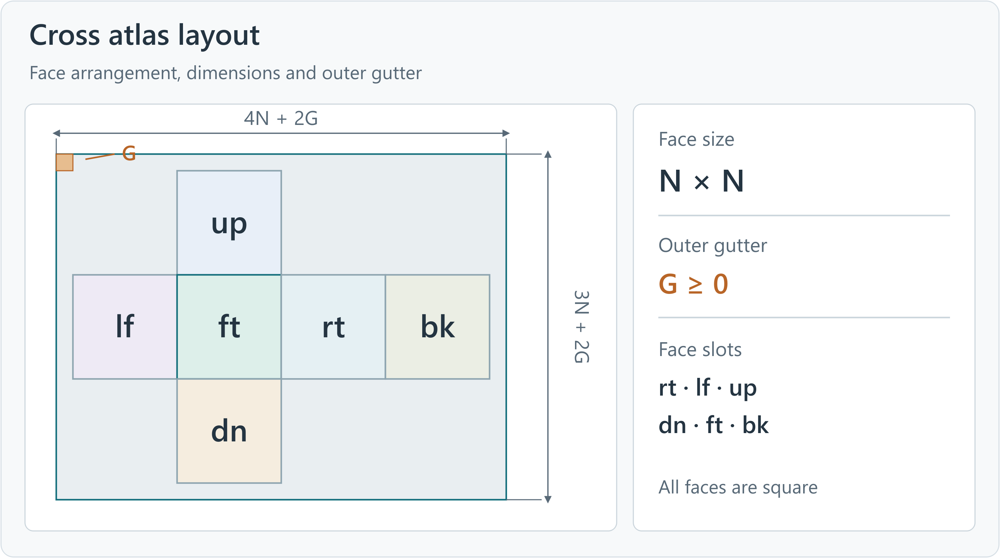
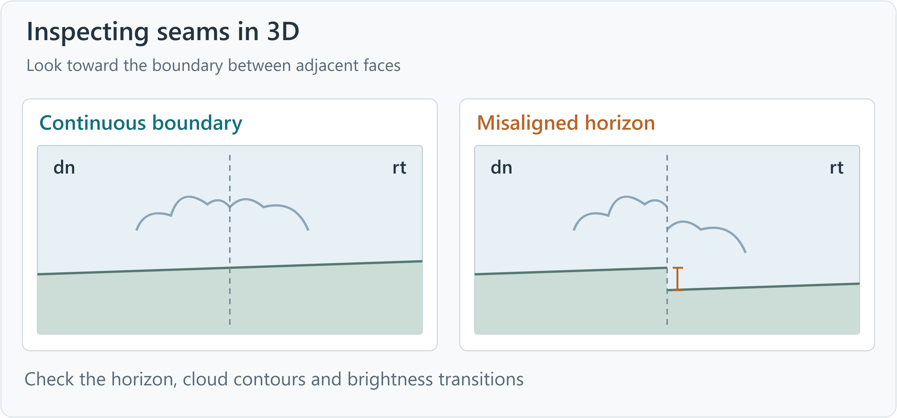
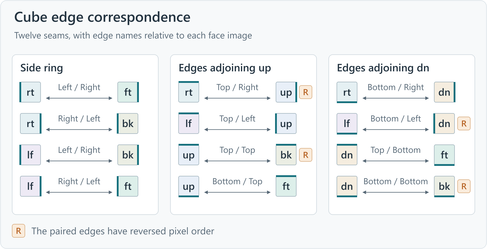

# Cubemap IWI User Guide

This guide describes asset import, preview and export, and the image-loading capacity of the stock game engines. Installation and development requirements are documented in the [README](README.en.md).

## 1 Asset import

Each document tab stores its source, processing settings and view state. Cross atlas PNGs, panorama PNGs and IWI files can be imported through the File menu or by drag and drop. Use **File → Open six PNG faces / Open six DDS faces** to assign separate face files. Source reading and preview loading run in the background.

IWI input supports COD4 v6 and MW2/MW3 v8 in uncompressed RGB24, DXT1 or DXT5, with one mip level. Layout and dimension requirements for image sources are described below.

### 1.1 Cross atlas

Figure 1 shows the cross atlas face arrangement. For face size N and outer gutter G, the image width is `4N + 2G` and its height is `3N + 2G`. G may be zero.

**Repair 4px RGB seams** adjusts edge pixels between adjacent faces and is enabled by default. Disabling it uses the original cropped pixels. Alpha is supplied by a matching 8-bit grayscale PNG and is processed independently of RGB seam repair.

### 1.2 Panorama

Panorama input requires a full 360° × 180° equirectangular PNG with a 2:1 aspect ratio. Import it with **Open panorama PNG**, then set the face size and horizontal rotation in the asset panel. The image center corresponds to the default 3D viewing direction, with the zenith at the top. Embedded PNG Alpha uses the same projection coordinates.

Face size determines the resolution of the generated faces. Horizontal rotation sets their overall orientation.

| Parameter | Setting |
| --- | --- |
| Face size | 512, 1024, 2048 or 4096 pixels |
| Default size | Largest available size no greater than one quarter of the source width; 512 for smaller inputs |
| Horizontal rotation | 0°–359.9°, default 0°; sets the orientation of the output skybox |

### 1.3 Separate face files

Assign the six faces to `rt / lf / up / dn / ft / bk`. The supplied pixel orientation is preserved. PNG faces must be square and match in dimensions, while their sizes on disk may differ. DDS faces also require matching DXT1 or DXT5 compression, legacy single-face FOURCC headers and one mip level.

## 2 Preview and comparison

### 2.1 2D canvas

The 2D canvas offers single-face, cross atlas, 3×2 grid and panorama layouts. Switching layouts preserves the selected face. **More → View original image** displays the imported cross atlas or panorama.

The mouse wheel zooms around the pointer. Pan with the middle button, or with Space and the left button. Double-click fits the image to the canvas. `Ctrl+1` selects actual-pixel display. The footer shows image dimensions, zoom and channel values at the pointer.

Assets with Alpha support **RGB**, **Alpha** and **Composite** views. Composite blends RGB over the current canvas background using Alpha. Select the checkerboard background to identify transparent areas.

### 2.2 Compression comparison

**Compress current face** generates a DDS preview using the current encoding settings. **Wipe** compares the input and compressed result across a movable divider. **Side by side** displays both stages together. The result summary records the format, device and quality used by the existing preview. Regenerate the preview to apply changed settings.

### 2.3 3D preview

With all six faces present, **3D preview** displays their assembled image from the cube center. Drag with the left button to change the viewing direction. The mouse wheel adjusts the vertical field of view. Double-click restores the default camera, a level view toward `dn` with a 75° vertical field of view. Select a face thumbnail to look toward that face.

Inspect the horizon, clouds and other structures across face boundaries. Figure 3 lists the twelve edge pairs. R marks paired edges whose pixel order is reversed.

## 3 Output settings

### 3.1 Export procedure

Select the output type in the output panel. For IWI output, select the target game. For re-encoding, set the format, device and quality. Specify the output folder and a name without an extension. Image output also requires export channels. Execute **Export** at the top right, then use **Open output folder** to access the completed files.

Game IWI writes one DXT1 or DXT5 IWI, and uncompressed IWI writes one RGB24 IWI. Six DDS faces and six PNG faces each produce six single-face files. Cross atlases, 3×2 grids and panoramas each produce one image. COD4 uses IWI v6. MW2/MW3 use IWI v8. For compressed DDS or IWI sources, **Preserve original blocks** packages the existing six face payloads, retaining their compressed blocks.

### 3.2 Formats and channels

IWI formats have the following data sizes and channel characteristics.

| Format | Data size | Data characteristics |
| --- | --- | --- |
| BC1/DXT1 | About 0.5 bytes per pixel | Opaque RGB |
| BC3/DXT5 | About 1 byte per pixel | RGB with separate Alpha |
| RGB24 | 3 bytes per pixel | Uncompressed, opaque RGB |

Image output supports RGB, Alpha and RGBA, producing three-channel color, single-channel grayscale or color with transparency. Export channels are independent of the canvas viewing channel. Faces without Alpha export an Alpha value of 255.

### 3.3 Encoding and tasks

Re-encoding defaults to CPU and Production quality. CUDA is available on compatible NVIDIA hardware. Authoring jobs execute one at a time, while document browsing remains available. Progress and errors appear in the task panel. Cancellation retains completed PNG and DDS files in the output folder. IWI output replaces the target file after the write is complete.

## 4 Stock engine capacity

The stock engines provide a fixed amount of per-image loading scratch space for IWI payloads, decoding and format-conversion data.

| Game | Stock per-image loading scratch capacity |
| --- | --- |
| COD4 | 6 MiB |
| MW2/MW3 | 12 MiB |

RGB24 is converted to 32-bit pixels before upload, requiring additional scratch space. The six RGB24 face payloads occupy `18 × N²` bytes, where N is the face size. Payload size is **18 MiB** at 1024 pixels per face and **72 MiB** at 2048. The estimated file size in the output panel includes the IWI header. Assets exceeding the stock loading capacity require engine enhancements.

Janus provides the relevant engine enhancement capabilities and is planned for a future open-source release.

## 5 Shortcuts

| Action | Shortcut |
| --- | --- |
| Open a cross atlas, panorama or IWI | `Ctrl+O` |
| Reload the source | `F5` |
| Close the current tab | `Ctrl+W` |
| Fit the image | `Ctrl+0` |
| Actual pixels | `Ctrl+1` |
| Switch compression stages | `Ctrl+Tab` |
| Toggle canvas focus | `Ctrl+Shift+F` |
| Open the user guide | `F1` |
