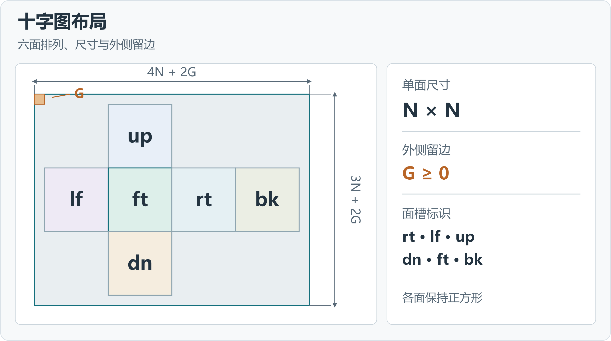
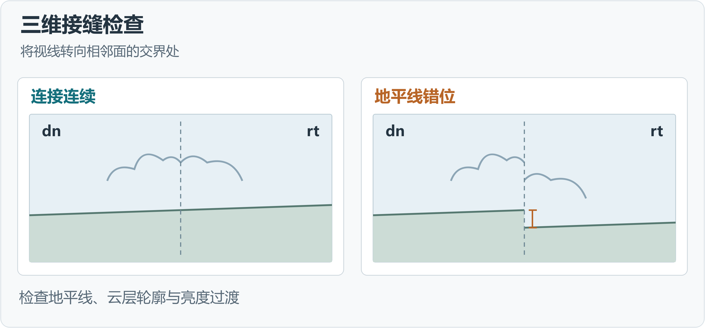
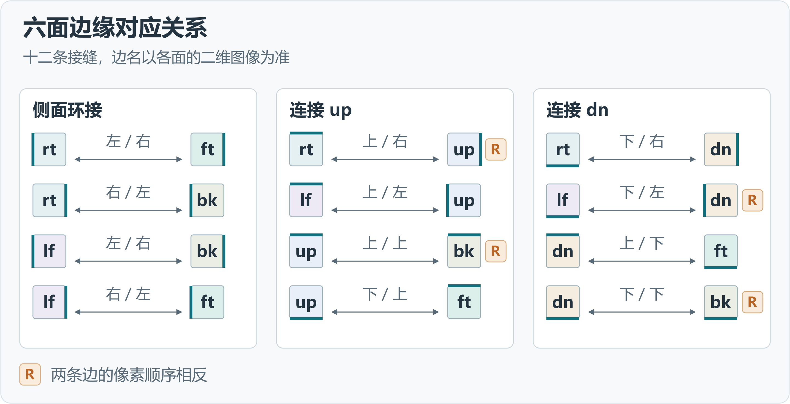

# Cubemap IWI 使用说明

本手册说明天空盒素材的导入、预览和输出操作，以及原版引擎的图片加载容量。安装和开发环境见 [README](README.md)。

## 1 素材导入

程序以标签管理素材，每个标签记录输入来源、处理参数和查看状态。十字 PNG、全景 PNG 和 IWI 可通过文件菜单或拖放导入，六面 PNG／DDS 通过**文件 → 打开六面 PNG／DDS**指定面槽。素材读取和预览加载在后台执行。

IWI 输入支持 COD4 的 v6 和 MW2／MW3 的 v8，格式包括未压缩 RGB24、DXT1 和 DXT5，要求单级 mipmap。各类图像来源的排列和尺寸要求见下文。

### 1.1 十字图

十字图的面槽排列见图 1。设单面边长为 N、外侧留边为 G，整图宽度为 `4N + 2G`，高度为 `3N + 2G`，G 可为零。

**4px RGB 修缝**调整相邻面的边缘像素，默认开启。关闭后，六面使用原始裁切像素。Alpha 由同尺寸的 8 位单通道灰度 PNG 提供，独立于 RGB 修缝处理。

### 1.2 全景图

全景输入须为完整的 360° × 180° 等距柱状 PNG，宽高比为 2∶1。通过**打开全景 PNG**导入后，在素材栏设置单面尺寸和水平朝向。图像中心对应 3D 预览的默认观察方向，顶部对应天顶。输入 PNG 自带的 Alpha 使用相同的投影坐标。

单面尺寸决定生成六面的分辨率，水平朝向设置整体旋转角度。

| 参数 | 设置 |
| --- | --- |
| 单面尺寸 | 512、1024、2048、4096 像素 |
| 默认尺寸 | 不超过原图宽度四分之一的最大可选尺寸；低于最小档时使用 512 |
| 水平朝向 | 0°～359.9°，默认 0°；调整输出天空盒的方向 |

### 1.3 独立六面贴图

六面按 `rt / lf / up / dn / ft / bk` 分配到对应面槽，保留输入文件的像素方向。PNG 须为尺寸一致的正方形，文件字节数可不同。DDS 六面还须采用相同的 DXT1 或 DXT5 格式、传统单面 FOURCC 头和单级 mipmap。

## 2 预览与对照

### 2.1 二维画布

二维画布提供单面、十字图、3×2 网格和全景布局，切换布局时保留所选面。**更多 → 查看原始图像**可打开导入的十字图或全景图。

滚轮以指针位置为中心缩放，中键拖动或空格加左键拖动用于平移。双击适应窗口，`Ctrl+1` 切换至实际像素显示。底部显示图像尺寸、缩放比例及指针位置的通道数值。

带 Alpha 的素材提供 **RGB**、**Alpha** 和**合并**视图。合并视图按 Alpha 将 RGB 叠加到当前画布背景，选择棋盘格背景可辨识透明区域。

### 2.2 压缩对照

**预览当前面压缩**根据当前编码设置生成所选面的 DDS 预览。**擦拭对照**通过分界线比较输入与压缩结果，**并排对照**同时显示两个阶段。结果摘要记录已有预览使用的格式、设备和质量参数，参数变更后可重新生成预览。

### 2.3 三维预览

六面齐全后可使用 **3D 预览**，从立方体中心观察六面拼合结果。左键拖动调整视线方向，滚轮调整垂直视野角，双击恢复默认视角，即水平朝向 `dn`、垂直视野角 75°。点击六面缩略图可转向对应面。

沿地平线、云层等跨面结构检查连接情况。图 3 列出十二条边的对应关系，R 标记表示两条边的像素顺序相反。

## 3 输出设置

### 3.1 导出流程

在输出栏选择输出类型，导出 IWI 时指定目标游戏，重新编码时设置格式、设备和质量。随后指定输出目录及不含扩展名的输出名称，图像输出还须选择导出通道。执行右上角的**导出**命令后，可在任务完成时通过**打开输出位置**访问生成文件。

游戏 IWI 输出一个 DXT1 或 DXT5 IWI，未压缩 IWI 输出一个 RGB24 IWI。六面 DDS 和六面 PNG 各输出六个单面文件，十字图、3×2 网格和全景图各输出一张图像。COD4 对应 IWI v6，MW2／MW3 对应 IWI v8。来源为压缩 DDS 或压缩 IWI 时，**保留原压缩正文**直接封装原有的六面数据，保留原压缩块。

### 3.2 格式与通道

IWI 格式的数据量与通道特性如下。

| 格式 | 数据量 | 数据特性 |
| --- | --- | --- |
| BC1／DXT1 | 约 0.5 字节／像素 | 不透明 RGB |
| BC3／DXT5 | 约 1 字节／像素 | RGB 与独立 Alpha |
| RGB24 | 3 字节／像素 | 未压缩、不透明 RGB |

图像导出可选择 RGB、Alpha 或 RGBA，分别生成三通道彩色、单通道灰度或带透明度的彩色 PNG。导出通道独立于画布查看通道，输入面未提供 Alpha 时按 255 输出。

### 3.3 编码与任务

重新编码默认使用 CPU 和 Production（生产质量），兼容的 NVIDIA 显卡可使用 CUDA。制作任务逐个执行，期间可切换标签查看素材。进度和错误记录位于底部任务区。取消任务后，已完成的 PNG 和 DDS 文件保留在输出目录。IWI 在完整写入后替换目标文件。

## 4 原版引擎容量

原版引擎为单张图片加载提供固定容量的暂存空间，用于 IWI 正文及解码、格式转换数据。

| 游戏 | 原版单张图片加载暂存容量 |
| --- | --- |
| COD4 | 6 MiB |
| MW2／MW3 | 12 MiB |

RGB24 上传前须转换为 32 位像素，转换过程需要额外暂存空间。六面 RGB24 正文为 `18 × N²` 字节，其中 N 为单面边长。单面 1024 时正文为 **18 MiB**，单面 2048 时为 **72 MiB**。输出栏显示的预计文件大小包含 IWI 头部。超过原版加载容量的素材须通过引擎增强设施加载。

Janus 已提供相关引擎增强能力，计划未来开源。

## 5 快捷键

| 操作 | 快捷键 |
| --- | --- |
| 打开十字图、全景图或 IWI | `Ctrl+O` |
| 重新读取来源 | `F5` |
| 关闭当前标签 | `Ctrl+W` |
| 适应窗口 | `Ctrl+0` |
| 实际像素 | `Ctrl+1` |
| 切换压缩阶段 | `Ctrl+Tab` |
| 切换专注画布 | `Ctrl+Shift+F` |
| 打开使用说明 | `F1` |
